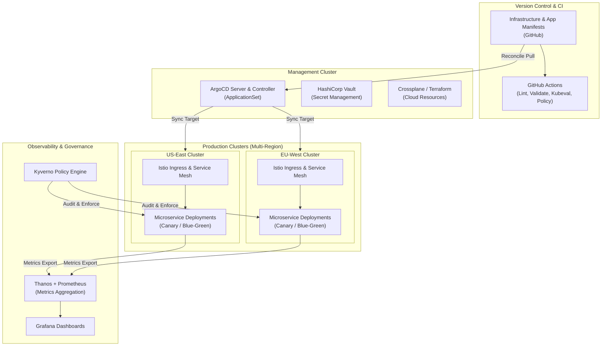

# CloudScale — Multi-Cluster Kubernetes GitOps Platform

[](#roadmap)
[](LICENSE)
[](#architecture)

> **CloudScale** is an enterprise-grade multi-cluster Kubernetes platform engineered for deterministic GitOps rollouts, automated declarative infrastructure provisioning, and continuous zero-downtime deployment pipelines.

---

## 🏛 System Architecture

The platform follows a pull-based declarative GitOps pattern. Cluster states are continuously reconciled with Git truth via ArgoCD ApplicationSets, with Istio managing canary traffic splitting and Prometheus gathering multi-tenant metric streams.



---

## 🚀 Key Engineering Pillars

1. **Pull-Based Declarative GitOps**: Eliminates cluster credentials from external CI runners; ArgoCD controllers continuously sync manifests from Git.
2. **Automated Canary Analysis with Flagger**: Integrates with Istio to shift traffic (10% &rarr; 25% &rarr; 50% &rarr; 100%) based on real-time Prometheus HTTP 5xx error rates and p99 latency thresholds.
3. **Zero-Trust Policy Enforcement**: Kyverno admission controllers validate pod security standards, enforce read-only root filesystems, and mandate cryptographic image signatures via Cosign.
4. **Unified Multi-Cluster Observability**: Thanos aggregates metrics across disparate geographic regions into a centralized, long-term S3-backed storage tier with Grafana alerting.

---

## 🛠 Technology Stack

| Layer | Technologies | Justification |
| :--- | :--- | :--- |
| **Orchestration** | Kubernetes v1.30+ | Declarative container orchestration standard |
| **GitOps Delivery** | ArgoCD, Kustomize, Helm | Multi-cluster synchronization with ApplicationSets |
| **Infrastructure as Code** | Terraform, OpenTofu | Deterministic cloud VPC, subnet, and IAM provisioning |
| **Service Mesh** | Istio | Mutual TLS (mTLS), fine-grained traffic routing, and distributed tracing |
| **Traffic Splitting** | Flagger | Automated progressive canary rollouts and metric evaluation |
| **Policy & Security** | Kyverno, Trivy, Cosign | Admission control, vulnerability scanning, and supply chain attestations |
| **Observability** | Thanos, Prometheus, Grafana, OpenTelemetry | Global metric aggregation and distributed trace visualization |

---

## 📐 Project Directory Structure

```text
cloudscale-gitops/
├── apps/                        # Application definitions
│   ├── base/                    # Shared Kustomize bases
│   └── overlays/                # Environment-specific patches (dev, staging, prod)
├── bootstrap/                   # Initial cluster bootstrapping
│   ├── argocd/                  # ArgoCD installation manifests
│   └── root-application.yaml    # App-of-apps parent manifest
├── infrastructure/              # Terraform / Cloud modules
│   ├── modules/                 # Reusable VPC, EKS/GKE, and IAM modules
│   └── environments/            # Live environment state configurations
├── policies/                    # Admission control & security
│   └── kyverno/                 # Pod security, network, and registry policies
└── monitoring/                  # Observability manifests
    ├── prometheus/              # Prometheus operator & alerts
    └── thanos/                  # Thanos query, store, and compactors
```

---

## 🗺 Engineering Roadmap

- [x] **Phase 1: Architecture RFC & System Specification** (Complete)
- [ ] **Phase 2: Base Infrastructure Module & Kustomize Foundations**
- [ ] **Phase 3: ArgoCD ApplicationSet & Progressive Canary Pipelines**
- [ ] **Phase 4: Thanos Multi-Cluster Aggregation & Chaos Engineering Tests**

---

## 📄 License
This project is open-source and licensed under the [MIT License](LICENSE).
